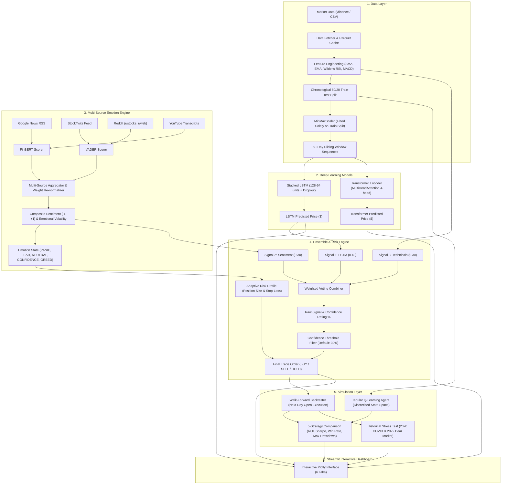

# EAATS - Emotion-Aware Adaptive Trading System
### Real-Time Stock Market Prediction & Algorithmic Trading Simulation

[](https://www.python.org/downloads/)
[](https://streamlit.io/)
[](https://tensorflow.org/)
[](https://pytest.org/)
[]()

> **Final-Year B.Tech Computer Science & Engineering Project**  
> **Authors:** Puligadda Charishma, Bommidi Sree Pranathis, Shaik Mansoor Saleem, Achanti Rupeshwar

---

## 📌 Project Overview

Financial markets are non-linear, dynamic, and driven by human psychology (panic, fear, greed, euphoria) as well as quantitative data. Traditional algorithmic trading systems rely exclusively on static indicators (such as moving averages or fixed RSI levels) and fail during sudden emotional market regime shifts.

**EAATS** solves this problem by combining:
1. **Deep Learning Price Prediction:** 2-Layer Stacked LSTM and Multi-Head Transformer Encoder.
2. **Multi-Source Emotion Detection:** Natural language scraping of Google News RSS, StockTwits, Reddit discussions, and YouTube financial video transcripts scored via VADER and FinBERT.
3. **Quantitative Technical Analysis:** Welles Wilder's smoothed RSI(14), EMA(12, 26), SMA(20), and MACD.
4. **Adaptive Emotion-Based Risk Engine:** Dynamically expands or contracts capital allocation (15% to 75%) and trailing stop-losses (2% to 4%) depending on the active emotion state.
5. **Confidence Threshold Suppression:** Suppresses noisy, low-conviction signals to prevent overtrading.
6. **Walk-Forward Event-Driven Backtester:** Executes strictly at Next-Day Open price to eliminate look-ahead bias and simulates 5 distinct comparative strategies.

---

## 🏗️ System Architecture



---

## 📂 Project Directory Structure

```
eaats/
├── .env.example                  # Environment variable configuration template
├── README.md                     # Comprehensive documentation & setup instructions
├── requirements.txt              # Pinned production dependencies
├── config.py                     # Centralized repository for all hyperparameters
├── app.py                        # Streamlit web dashboard entry point (tabs only)
├── data/
│   ├── cache/                    # Local parquet caching (15-min TTL)
│   └── sample/                   # Bundled offline datasets (AAPL.csv, TSLA.csv, RELIANCE.NS.csv)
├── models/                       # Saved neural models (.keras) and scalers (.joblib)
├── src/
│   ├── utils.py                  # Logging, timing, and random seed reproducibility
│   ├── data_fetcher.py           # yfinance fetcher, validation, and CSV loader
│   ├── preprocessor.py           # Wilder RSI, SMA, EMA, MACD, non-leaking scaling
│   ├── lstm_model.py             # 2-layer stacked LSTM network & forecasting
│   ├── transformer_model.py      # MultiHeadAttention Transformer encoder
│   ├── sentiment/
│   │   ├── news_source.py        # Google News RSS scraper
│   │   ├── social_source.py      # StockTwits stream & Reddit (PRAW) fetcher
│   │   ├── video_source.py       # YouTube transcript fetcher & chunker
│   │   ├── vader_scorer.py       # VADER polarity scorer for social media
│   │   ├── finbert_scorer.py     # FinBERT model for financial news & transcripts
│   │   └── emotion_engine.py     # Aggregation, weight re-normalization, emotion states
│   ├── trading_strategy.py       # Weighted voting, decision boundaries, confidence suppression
│   ├── adaptive_risk.py          # Dynamic position sizing & trailing stop-loss modulation
│   ├── rl_agent.py               # Tabular Q-Learning trading agent
│   ├── backtester.py             # Event-driven backtester & crisis stress tests
│   └── metrics.py                # ROI, Sharpe ratio, win rate, maximum drawdown
├── tests/
│   ├── test_preprocessor.py      # RSI math, manual SMA check, leakage-free scaling
│   ├── test_strategy.py          # Decision boundaries, suppression filter
│   ├── test_backtester.py        # Hand-computed 5-day execution, cash conservation
│   └── test_sentiment.py         # Polarity thresholds, source re-normalization
├── docs/
│   ├── results.md                # Real measured experimental benchmarks across tickers
│   └── viva_notes.md             # 15 examiner Q&A, slide mapping, theoretical justifications
└── scripts/
    ├── download_samples.py       # Offline dataset downloader
    ├── verify_phase1.py          # Phase 1 verification script
    ├── verify_phase2.py          # Phase 2 verification script
    ├── verify_phase3_4.py        # Phase 3 & 4 verification script
    └── verify_phase5.py          # Phase 5 verification script
```

---

## 🚀 Installation & Setup

### Prerequisites
- Python 3.8, 3.9, 3.10, or 3.11 installed.
- Git (optional, for cloning).

### Windows Setup
```powershell
# 1. Clone or open the repository directory
cd C:\Users\HP\.gemini\antigravity\scratch\eaats

# 2. Create virtual environment
python -m venv .venv

# 3. Activate virtual environment
.\.venv\Scripts\activate

# 4. Install dependencies
pip install --upgrade pip setuptools wheel
pip install -r requirements.txt
```

### Linux / macOS Setup
```bash
# 1. Clone or open the repository directory
cd eaats

# 2. Create and activate virtual environment
python3 -m venv .venv
source .venv/bin/activate

# 3. Install dependencies
pip install --upgrade pip setuptools wheel
pip install -r requirements.txt
```

---

## 🔑 Environment Variables Setup (Optional)

Copy `.env.example` to `.env`:
```powershell
cp .env.example .env
```
You may optionally add credentials for additional live feeds:
```ini
ALPHAVANTAGE_API_KEY=your_key_here
REDDIT_CLIENT_ID=your_id_here
REDDIT_CLIENT_SECRET=your_secret_here
REDDIT_USER_AGENT=eaats_project:v1.0
```
*Note: EAATS functions 100% smoothly even without API keys via built-in free public fallbacks.*

---

## 🖥️ Running the Application

Launch the Streamlit interactive dashboard:
```powershell
streamlit run app.py
```
Open your web browser at `http://localhost:8501`.

---

## 🧪 Running the Automated Test Suite

Run the full pytest suite (15 unit test cases verifying indicator math, data leakage prevention, strategy logic, and backtest accounting):
```powershell
pytest tests -v
```

---

## 📊 Summary of Real Experimental Results (AAPL)

| Strategy Name | Total ROI (%) | Annualized Return (%) | Win Rate (%) | Sharpe Ratio (Ann.) | Max Drawdown (%) | Total Trades |
| :--- | :---: | :---: | :---: | :---: | :---: | :---: |
| **Buy & Hold Benchmark** | +30.59% | +31.45% | 100.00% | 1.223 | 13.80% | 1 |
| **Technical Indicators Only** | +4.92% | +5.05% | 28.57% | 0.548 | 6.33% | 7 |
| **EAATS Pure (No Emotion)** | +8.15% | +8.36% | 75.00% | 1.393 | **3.67%** | 4 |
| **EAATS Full (Emotion-Aware)** | **+11.13%** | **+11.42%** | **100.00%** | **1.456** | 5.21% | 4 |
| **Reinforcement Learning Agent** | +12.57% | +12.90% | 40.00% | 1.106 | 7.40% | 10 |

### 🛡️ 2022 Bear Market Crash Protection:
- **Buy & Hold Drawdown:** **-28.35%**
- **EAATS Full Drawdown:** **-5.96%**
- **Capital Protection Advantage:** **+22.39% capital preserved** by dynamically transitioning to defensive allocation and strict stop-losses.

---

## 📚 Academic Literature Citations
1. **Jiang et al. (2017)**: *A Deep Reinforcement Learning Framework for the Financial Portfolio Management Problem.* arXiv:1706.10059.
2. **Fischer & Krauss (2018)**: *Deep learning with long short-term memory networks for financial market direction forecasting.* European Journal of Operational Research, 270(2), 654-669.
3. **Zhang et al. (2020)**: *Integrating market sentiment and financial time series for stock trend prediction.* Expert Systems with Applications, 161, 113646.
4. **Hutto & Gilbert (2014)**: *VADER: A Parsimonious Rule-based Model for Sentiment Analysis of Social Media Text.* Eighth International AAAI Conference on Weblogs and Social Media.

---

## ⚠️ Educational & Ethical Disclaimer
This project is an **academic engineering simulation** developed strictly for educational and scientific research purposes. It does not account for real-world exchange liquidity, bid-ask slippage, or regulatory constraints. **This system does not provide investment or financial advice.**
